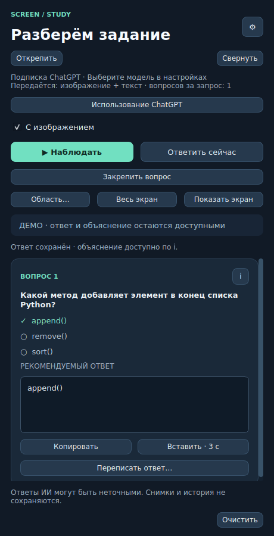

# ScreenStudy

Учебный помощник для **macOS 14+ на Apple Silicon**. Читает выбранную область экрана, показывает рекомендуемый ответ и объясняет решение в небольшом боковом окне.

**Версия 1.3.0.** Репозиторий содержит исходный код и установщик, который собирает приложение на вашем Mac.



На изображении показан демонстрационный вопрос, а не результат захвата пользовательского экрана.

## Возможности

- Автоматическое наблюдение за выбранной областью или разовый запрос.
- Локальное распознавание текста через Apple Vision.
- Подключение Ollama, Groq, совместимых API и ChatGPT через доступную для аккаунта подписку.
- Ответы на открытые вопросы и отметки рекомендуемых вариантов.
- Сопоставление карточек: все пары «что перенести → куда», одинаковые номера у элементов пары.
- Выделение ключевых слов: точные цитаты по каждому абзацу, проверка цитат по OCR и номера рядом со строками.
- Объяснение по кнопке **i**, копирование, вставка и переписывание ответа.
- Сохранение карточки при движении мыши и изменениях страницы.
- **Закрепить вопрос / Следующий вопрос** для управления автоматическими запросами.
- Закрепление окна поверх приложений, сворачивание и просмотр выбранной области.

## Установка

1. Скачайте репозиторий через **Code → Download ZIP** и распакуйте его.
2. Если ScreenStudy уже запущена, полностью закройте её через **⌘Q**.
3. Откройте **INSTALL.command**. Если Finder не запускает файл, введите в Терминале `bash ` с пробелом, перетащите туда файл и нажмите Enter.
4. Следуйте сообщениям установщика. Для установки нужен интернет; если Python отсутствует, установщик объяснит, как установить его.
5. Разрешите запись экрана для ScreenStudy, затем перезапустите приложение и настройте модель через **⚙**.

Приложение устанавливается в `~/Applications/ScreenStudy.app`. Следующие запуски — из этой папки или через **START.command**.

Полная инструкция по моделям, подписке, разрешениям macOS и устранению ошибок: **[README_RU.md](README_RU.md)**. Иллюстрированный быстрый запуск: откройте **START_HERE.html** из скачанной папки.

## Использование

Выделите область одного вопроса вместе с вариантами и рисунками. Нажмите **Наблюдать** или **Ответить сейчас**. Для текстовых заданий можно отключить передачу изображения; для формул и схем оставьте её включённой.

Последний ответ и объяснение остаются доступными при изменениях экрана. В режиме наблюдения карточка заменяется после готовности нового ответа. **Закрепить вопрос** блокирует автоматические запросы новых заданий; **Следующий вопрос** возобновляет наблюдение. Объяснение и переписывание по нажатию могут отправлять отдельные запросы.

При прокрутке метки на странице временно скрываются и возвращаются только при надёжном сопоставлении строк. Объяснение использует снимок, по которому получен показанный ответ.

### Сопоставление и выделение слов

Выделите всё задание: инструкцию, обе колонки карточек или все пронумерованные абзацы. Нажмите **Ответить сейчас** или **Наблюдать**. Тип задания определяется автоматически. Параметр «Вопросов за запрос: 1» включает все пары и абзацы под общей инструкцией. Когда ответ готов, нажмите **Закрепить вопрос**, чтобы ручное перемещение карточек и выделение слов не вызывало новые автоматические запросы.

- **Сопоставление:** переносите текст слева от стрелки к получателю справа от стрелки. Одинаковые номера на экране помогают найти пару. Для сложного расположения включите **С изображением**, если модель поддерживает изображения.
- **Ключевые слова:** нажимайте в задании точные цитаты из карточки ответа. Номер на экране указывает строку; он не означает, что нужно выделить всю строку. Фразы, которых нет в распознанном тексте, скрываются с предупреждением. При ошибке OCR увеличьте масштаб страницы или выберите область заново.
- **i** объясняет каждую пару или выбранную фразу. Кнопка **Копировать** копирует весь список. Перетаскивание и выбор слов выполняются вручную; автоматической отправки ответа нет.
- Если инструкция явно ссылается на предыдущий вопрос, передаётся один предыдущий ответ (до 2800 символов суммарно). Он может быть ошибочным. Если предыдущего ответа нет, приложение предупреждает об этом. **Очистить** удаляет этот контекст вместе с текущим ответом.

На определённое составное задание делается один запрос: в быстром режиме лимит ответа API/Ollama повышается минимум до 4096 токенов, чтобы вместить все части. Объяснение запрашивается отдельно по кнопке **i**. Скорость и точность зависят от выбранной модели.

## Данные и ограничения

- В облачном режиме выбранная область или её распознанный текст передаются выбранному провайдеру. Учитывайте его лимиты и условия хранения данных.
- Приложение не записывает снимки и историю ответов на диск. Текущий снимок и последний ответ хранятся в памяти до очистки или закрытия.
- Настройки и сеансы ChatGPT хранятся локально вне репозитория. Не публикуйте файлы из `~/Library/Application Support/ScreenStudy`.
- Ответы ИИ могут быть ошибочными. Очень мелкие графические изменения могут не вызвать новый автоматический запрос — в таком случае используйте **Ответить сейчас**.
- Установщик собирает приложение локально; готовой подписанной и нотарифицированной сборки в репозитории нет.

## Разработка и тесты

Для запуска из исходников создайте виртуальное окружение и установите зависимости:

```bash
python3 -m venv .venv
source .venv/bin/activate
python -m pip install -r requirements.txt
python main.py
```

Демонстрация интерфейса без захвата экрана:

```bash
python main.py --demo
```

Автоматические проверки:

```bash
QT_QPA_PLATFORM=offscreen python -m unittest discover -s tests -v
```


Подробности проверок: [VERIFICATION.txt](VERIFICATION.txt). Изменения: [CHANGELOG.md](CHANGELOG.md).
